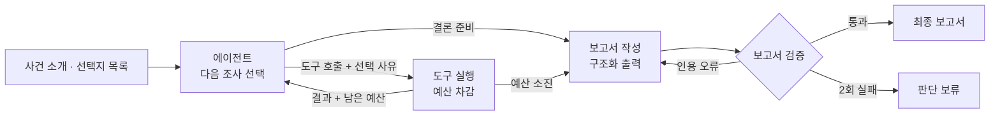
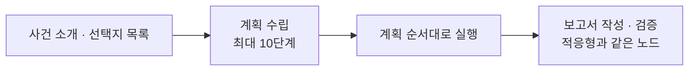

# 🔎 Cluvelle — 제한된 조사 예산으로 사건을 푸는 AI 탐정 에이전트

> 정답도 단서도 모르는 AI 탐정이 **조사 예산 10회** 안에서 스스로 조사 도구를 골라 증거를 모으고, 진술과 기록이 어긋나면 다음 조사를 바꿔 **확보한 증거만 인용해** 결론을 내거나 판단을 보류하는 LangGraph 미스터리 수사 웹앱

| 항목 | 내용 |
|---|---|
| 기간 | 2026.11.20 ~ 진행 중 (10일 개발 계획) |
| 인원 | 1명 (개인 프로젝트) |
| 역할 | 사건 시나리오 설계 · 조사 도구 · LangGraph 에이전트 · 검증 스크립트 · CI/CD · 배포 전체 |
| 기술 | Python · FastAPI · LangGraph · Gemini API · React · TypeScript · Tailwind CSS |
| 배포 | [웹 (Vercel)](https://cluvelle.vercel.app) · [API 상태 확인 (Render)](https://cluvelle-api.onrender.com/api/health) |
| 진행 상태 | 사건 5개 · 조사 도구 · 적응형/고정 계획형 에이전트 · CI/CD 완료 → API · 화면 · 비교 실험 진행 예정 |

---

## 목차

| # | 구분 | 내용 |
|---|---|---|
| 01 | 프로젝트 개요 | 배경 · 핵심 질문 · 목표 · 범위 |
| 02 | 수행 범위와 기술 | 기능 요구사항 진행 상황 · 기술 스택 |
| 03 | 사건 데이터 | 사건 5개 · 데이터 구조 · 설계 규칙 |
| 04 | 조사 도구와 교차 검증 | 도구 5개 · 교차 검증 규칙 |
| 05 | 에이전트 구조 | 적응형 · 고정 계획형 · 보고서 검증 |
| 06 | 검증과 배포 | 사건 검증 스크립트 · 테스트 · CI/CD |
| 07 | 문제 분석 및 개선 과정 | 개발 중 발견한 문제와 수정 |
| 08 | 남은 작업 | 남은 개발 일정 |
| 09 | 실행 방법 | 로컬 실행 · 저장소 구성 |

---

# 01. 프로젝트 개요

## 1.1 배경

LLM 에이전트 데모는 대개 필요한 정보를 처음부터 모두 주고 답을 고르게 합니다. 실제 조사는 다릅니다. 무엇을 먼저 볼지 골라야 하고, 조회할 때마다 비용이 들고, 증언과 기록이 서로 어긋나기도 합니다.

Cluvelle은 이 상황을 가상 미스터리 사건으로 옮겼습니다. AI 탐정은 사건 소개와 조사 가능한 선택지 목록만 보고 시작하며, 내용은 도구를 호출해야만 알 수 있습니다.

## 1.2 핵심 질문

> **제한된 정보와 도구 사용 예산 안에서, 조사 결과를 보고 전략을 바꾸는 것이 실제 성능에 어떤 영향을 주는가?**

이를 확인하기 위해 같은 사건 · 도구 · 예산 · 초기 정보로 두 방식을 실행해 비교합니다.

| 방식 | 동작 |
|---|---|
| 적응형 | 도구를 하나 호출할 때마다 결과를 보고 다음 조사를 정함 |
| 고정 계획형 | 처음에 조사 계획을 한 번 세우고 그대로 실행함 |

## 1.3 목표

- 사건 5개를 **조사 예산 10회** 안에서 풀 수 있게 설계 (최단 해결 경로 5~6회)
- 에이전트가 **확보하지 않은 증거는 인용할 수 없도록** 서버에서 검증
- 근거가 부족하면 억지로 지목하지 않고 **판단 보류**
- 5개 사건 × 3회 × 2방식 = **30회 실행 결과**를 기록해 두 방식을 비교
- PC와 360px 이상 모바일 브라우저에서 수사 과정을 실시간으로 관찰

## 1.4 범위

| 구분 | 항목 |
|---|---|
| 포함 | 사건 5개, 조사 도구 5개, 반복 조사, 증거 검증, 고정 계획형 비교 실험, 모바일 UI, 공개 배포, CI/CD |
| 제외 | 회원가입 · 로그인, 결제, 사건 자동 생성, 실제 CCTV 영상, 멀티 에이전트 |

---

# 02. 수행 범위와 기술

## 2.1 기능 요구사항 진행 상황

| ID | 요구사항 | 상태 |
|---|---|---|
| FR-01 | 사건 목록 · 상세 및 수사 시작 | 진행 예정 (Day 7~8) |
| FR-02 | 수사 도구 자율 선택 | ✅ 완료 (CLI로 실행 확인) |
| FR-03 | 증거 수집 및 상태 누적 | ✅ 완료 |
| FR-04 | 모순 발견 시 재조사 | ✅ 완료 |
| FR-05 | 중복 · 횟수 제한 (사건당 최대 10회) | ✅ 완료 |
| FR-06 | 결과 보고서 (지목 또는 판단 보류, 증거 ID) | ✅ 완료 |
| FR-07 | 실시간 진행 화면 (타임라인) | 진행 예정 (Day 7~8) |
| FR-08 | 수사 종료 후 정답 확인 · 평가 | 진행 예정 |
| FR-09 | 반응형 UI | 진행 예정 (Day 8) |
| FR-10 | 공개 배포 · 자동 검사 | ✅ 완료 (CI 통과 후에만 배포) |
| FR-11 | 고정 계획형 비교 실험 | 그래프 완료 · 30회 실험 진행 예정 (Day 9) |

## 2.2 기술 스택

| 영역 | 기술 | 역할 |
|---|---|---|
| Backend | Python 3.12 · uv · FastAPI · Pydantic | API 서버, 사건 · 도구 · 보고서 스키마 |
| Agent | LangGraph · langchain-google-genai · Gemini API | 적응형 · 고정 계획형 수사 그래프 |
| Frontend | React 19 · Vite · TypeScript · Tailwind CSS v4 | 사건 선택 · 수사 타임라인 · 결과 화면 |
| 품질 | Ruff · pytest · ESLint · Prettier | 린트 · 포맷 · 테스트 |
| 배포 | Render (API) · Vercel (웹) · GitHub Actions | CI 통과 후 main 브랜치만 배포 |

> Gemini 모델은 추가 학습하지 않고, **도구 설계 · 프롬프트 · 서버 측 검증**으로 활용합니다. 기본 모델은 환경변수(`GEMINI_MODEL`)로 바꿀 수 있습니다.

---

# 03. 사건 데이터

## 3.1 사건 구성

| ID | 난이도 | 사건 | 수사 구조 | 조사 조합 | 증거 | 최단 경로 |
|---|---|---|---|---|---|---|
| CASE-001 | 입문 | 연구실 시제품 도난 | 진술과 출입 기록 충돌, CCTV 시간대 교차 확인 | 30 | 22 | 5 |
| CASE-002 | 입문 | 미술관 전시품 분실 | CCTV 사각지대와 목격자 진술 검증 | 31 | 22 | 5 |
| CASE-003 | 보통 | 호텔 객실 귀중품 도난 | 출입 기록 · 청소 일정 · 동선 비교 | 34 | 26 | 6 |
| CASE-004 | 보통 | 카페 비밀 레시피 유출 | 접근 권한 · 문서 열람 기록 · 허위 단서 | 33 | 23 | 6 |
| CASE-005 | 도전 | 공연장 소품 교체 사건 | 시간표 · 물품 이동 기록 · 서로 충돌하는 알리바이 | 30 | 25 | 6 |

- 모든 사건: 용의자 3명, 결정적 증거 3개, 오해를 유발하는 증거 2개, 조사 예산 10회
- 조사 조합 = 장소 + 용의자 × 질문 주제 + 카메라 × 시간대 + 알리바이 확인
- 조합의 일부는 "특이사항 없음"을 돌려줌 → 무작정 다 조회하면 예산이 모자람
- 모든 인물 · 기관 · 사건은 가상입니다

## 3.2 데이터 구조

사건마다 **공개 정보 파일**과 **정답 파일**을 나눴습니다.

| 파일 | 내용 | 접근 |
|---|---|---|
| `backend/data/cases/CASE-XXX.json` | 사건 소개, 용의자 · 장소 · 카메라 · 질문 주제 목록, 증거 | 목록은 공개, 증거는 도구로만 조회 |
| `backend/data/answers/CASE-XXX.json` | 범인, 결정적 · 오해 유발 증거, 해결 경로, 채점 메모 | 조사 도구 · 에이전트 코드에서 import 금지 |

증거 한 건은 **어느 도구로 어디를 조회하면 나오는지**(`source_tool` + `locator`)와, 교차 검증에 쓰는 **시간 · 장소 사실**(`facts`)을 가집니다.

```json
{
  "id": "E11",
  "source_tool": "interview_suspect",
  "locator": { "suspect_id": "S3", "topic_id": "T1" },
  "summary": "15:30부터 16:00까지 창고에서 원두 포대를 정리했다.",
  "facts": [
    { "kind": "claim", "person_id": "S3", "place": "L5", "start": "15:30", "end": "16:00" }
  ]
}
```

| facts 필드 | 의미 |
|---|---|
| `kind` | `claim`(진술) / `record`(CCTV · 기록) |
| `person_id` | 인물 ID, 얼굴이 식별되지 않은 기록은 `null` |
| `place` | 장소 ID, 현장 밖이면 `off_site` |
| `start` · `end` | 같으면 그 시각의 순간 기록 |

## 3.3 사건 설계 규칙

| 규칙 | 이유 |
|---|---|
| 정답이 **한 번의 조회로 드러나지 않게** 결정적 증거를 서로 다른 위치에 분산 | 운 좋게 정답 단서를 뽑는 구조 방지 |
| 단서가 다음 조사 방향을 알려 주도록 연결 | 추론으로 경로를 찾을 수 있게 |
| 통과한 순간은 **순간 기록**으로, 체류로 늘리지 않음 | 관측보다 강한 사실이 생기지 않게 |
| 진술은 **말한 그대로** 기록 ("15:40쯤" = 순간, "~에서 ~사이" = 구간) | 추정은 문장에만 남김 |
| **서명 · 계정 입력은 사람의 위치로 기록하지 않음** | 서명 위조 · 계정 도용이 사건의 함정이 될 수 있음 |
| 배제는 반드시 기록으로 뒷받침 | 근거 없는 알리바이 단정 방지 |
| 관측된 것과 추론한 것을 채점 메모에서 구분 | 보고서가 추론을 사실처럼 쓰지 않게 |

---

# 04. 조사 도구와 교차 검증

## 4.1 조사 도구 5개

| 도구 | 입력 | 결과 |
|---|---|---|
| `inspect_scene` | 장소 | 현장 흔적 · 장비 기록 |
| `interview_suspect` | 용의자 × 질문 주제 | 진술 |
| `check_cctv` | 카메라 × 시간대 | CCTV 관찰 기록 |
| `verify_alibi` | 용의자 | 출입 · 근무 · 단말 기록 |
| `cross_check_evidence` | 확보한 증거 2~5개 | 증거 사이의 시간 · 장소 관계 |

에이전트에게는 증거 ID · 도구 · 요약 문장만 보여 주고, `facts`는 교차 검증 계산에만 씁니다.

## 4.2 교차 검증 규칙

교차 검증은 **판단하지 않고 관계만** 돌려줍니다. 결론은 에이전트가 내려야 합니다.

| 관계 | 의미 |
|---|---|
| `same_person_overlap_different_place` | 같은 인물, 시간대 겹침, 장소 다름 |
| `same_person_overlap_same_place` | 같은 인물, 시간대 겹침, 장소 같음 |
| `different_people_same_place_overlap` | 다른 인물, 같은 장소, 시간대 겹침 |
| `unidentified_time_overlap` | 신원 미상 기록과 시간대만 겹침 (특정 인물과 연결하지 않음) |

- 서로 다른 증거의 사실끼리만 비교
- 겹침: 공통 구간이 있거나 순간 기록이 구간 경계에 걸침. **끝점만 맞닿은 두 구간은 겹침 아님**
- 결과 문장에 "거짓 · 범인 · 모순 · 의심" 같은 결론 단어를 쓰지 않음

**예시** — CASE-004에서 "창고에 있었다"는 진술과 직원 통로 CCTV를 비교

```
['E11', 'E18'] 사실 관계 4건
  - same_person_overlap_different_place ['S3'] | E11(진술) S3 L5(창고) 15:30-16:00 / E18(기록) S3 L2(직원 통로) 15:38-15:38
  ...
```

같은 진술을 창고 CCTV와 비교하면 "장소 같음"만 나옵니다. 15:37~15:48의 공백은 CCTV 요약 문장을 읽어야 드러나도록 설계했습니다.

---

# 05. 에이전트 구조

## 5.1 적응형 (Adaptive)



## 5.2 고정 계획형 (Fixed plan)



- 교차 검증 단계는 앞 단계 번호(`source_steps`)로 대상 증거를 지정
- 보고서 작성 · 검증 노드를 두 방식이 공유해 비교 조건을 맞춤

## 5.3 실행 제한과 검증

| 제한 | 처리 |
|---|---|
| 조사 예산 | 사건당 10회. 잘못된 인자 · 사유 누락 · 없는 도구 · 중복 호출도 1회로 셈 |
| 선택 사유 | 모든 도구 호출에 `reason`(선택 사유 한 줄) 필수 → 화면에 판단 근거로 표시 |
| 미확보 증거 교차 검증 | 차단하고 예산 1회 차감 |
| 남은 예산 알림 | 도구 결과마다 "남은 조사 예산: n회" 표시 |
| 보고서 검증 | 없는 용의자 · 확보하지 않은 증거 · 증거 누락을 서버에서 검사 |
| 재작성 한도 | 검증 실패 시 재작성, 총 2회 실패하면 판단 보류 |
| LLM 오류 | 요청 제한 시간 60초, 재시도 2회, 오류 기록에서 API 키 형식 가림 |

## 5.4 중간 실행 관찰 (CASE-001)

| 방식 | 결과 |
|---|---|
| 적응형 (첫 버전) | 예산을 모두 쓰고 보고서 없이 종료 → 보고서 노드 분리 · 남은 예산 알림 추가 |
| 적응형 (개선 후) | 범인을 지목하고 결정적 증거 3개를 모두 인용 |
| 고정 계획형 | 처음 세운 계획이 모든 선택지를 고르게 훑는 방식이라 결정적 CCTV를 조회하지 못함 |

> 1회씩 실행한 관찰이라 성능 비교로 해석하지 않습니다. 정식 비교는 Day 9에 30회 실행으로 진행합니다.

---

# 06. 검증과 배포

## 6.1 사건 검증 스크립트

사건 데이터를 고칠 때마다 설계 규칙을 자동으로 확인합니다.

| # | 검사 |
|---|---|
| 1 | 용의자 수 |
| 2 | 조사 가능 조합 수 (25~35) |
| 3 | 결정적 증거 2~3개 · 오해 유발 증거 1~2개 |
| 4 | 해결 경로 길이 (5~6) |
| 5 | 해결 경로를 실제 도구로 실행했을 때 결정적 증거를 모두 확보하는지 |
| 6 | 한 조회 위치에 결정적 증거가 2개 이상 몰리지 않았는지 |
| 7 | 증거 요약에 결론 단어가 없는지 |

```
[CASE-005] 통과
  조합 30 (증거 있음 25 / 없음 5) · 결정적 3 · 오해 2 · 해결 경로 6
전체 5건 중 통과 5건, 실패 0건
```

## 6.2 테스트

- pytest **185개** 통과 (사건별 교차 검증 기대값, 도구, 에이전트 그래프, 보고서 검증, CLI)
- 에이전트 테스트는 가짜 LLM(`ScriptedChatModel`)으로 실행 → CI에서 실제 Gemini 호출 0회

## 6.3 CI/CD

```mermaid
flowchart LR
    A[develop push] --> B[CI<br/>backend · frontend]
    B --> C[배포 건너뜀]
    D[develop → main PR 머지] --> E[CI<br/>backend · frontend]
    E -->|모두 통과| F[Render · Vercel<br/>deploy hook 호출]
    F --> G[/api/health 확인]
```

| 작업 | 내용 |
|---|---|
| backend | `uv sync --locked` · Ruff 린트/포맷 검사 · pytest · 사건 검증 |
| frontend | `npm ci` · ESLint · 타입 검사 · Prettier 검사 · 빌드 |
| deploy | main push에서만, 두 작업 통과 후 deploy hook 호출 → health 응답을 최대 10분 확인 |

> API 키와 deploy hook URL은 코드 · Git에 두지 않고 GitHub Secrets와 각 서비스 환경변수에만 보관합니다.

---

# 07. 문제 분석 및 개선 과정

## ① 예산을 다 쓰고 결론 없이 끝나는 에이전트

| 구분 | 내용 |
|---|---|
| 문제 | 첫 실행에서 에이전트가 조사만 반복하다 예산을 모두 쓰고 보고서 없이 종료 |
| 원인 | 남은 예산을 알 수 없었고, 보고서 작성이 도구 호출 루프 안에 묶여 있었음 |
| 수정 | 보고서 노드를 분리해 예산이 소진돼도 반드시 보고서를 작성. 도구 결과마다 남은 예산 표시 |
| 결과 | 같은 사건에서 범인 지목과 결정적 증거 3개 인용까지 완료 |

## ② 관측보다 강한 사건 데이터

| 구분 | 내용 |
|---|---|
| 문제 | 복도를 지나간 순간을 "체류"로 기록해, 다른 사람의 목격 진술과 잘못 일치 판정됨 |
| 원인 | 시나리오 문장을 사실로 옮길 때 관측 범위를 넘어서 기록 |
| 수정 | 통과는 순간 기록, 진술은 말한 그대로, 서명 · 계정 입력은 사람 위치로 기록하지 않는 원칙을 세우고 사건 5개에 적용 |
| 결과 | 교차 검증 기대값을 사건마다 테스트로 고정 |

## ③ 겹침 판정 기준

| 구분 | 내용 |
|---|---|
| 문제 | 15:00-16:00 진술과 16:00-17:00 기록처럼 끝점만 맞닿은 구간까지 "겹침"으로 나옴 |
| 수정 | 끝점만 맞닿은 두 구간은 겹침에서 제외. 순간 기록이 경계에 걸치는 경우는 겹침으로 유지 |

## ④ Gemini 서버 과부하 (HTTP 503)

| 구분 | 내용 |
|---|---|
| 문제 | 기본 모델 호출이 503으로 반복 실패해 실행이 길게 멈춤 |
| 확인 | 단순 호출도 실패 → 코드가 아닌 서버 측 과부하 |
| 수정 | 요청 제한 시간 60초 · 재시도 2회 설정, 모델을 환경변수로 바꿀 수 있게 함 (경량 모델로 실행 확인) |

## ⑤ Windows 줄바꿈으로 실패한 포맷 검사

| 구분 | 내용 |
|---|---|
| 문제 | Windows에서 체크아웃한 파일이 CRLF가 되어 Prettier 검사 실패 |
| 수정 | `.gitattributes`에 `* text=auto eol=lf` 지정 |

---

# 08. 남은 작업

| 일정 | 작업 |
|---|---|
| Day 7 | 수사 실행 REST API · SSE 실시간 이벤트 (도구 호출 · 증거 · 가설 변경) |
| Day 8 | 사건 목록 · 수사 타임라인 · 결과 화면, 360px 모바일 대응 |
| Day 9 | 5개 사건 × 3회 × 2방식 = 30회 비교 실험, 결과 CSV 기록, 기본 모델 재결정 |
| Day 10 | 평가 결과 정리, 배포 점검, README 완성 |

---

# 09. 실행 방법

## 9.1 Backend

```bash
git clone https://github.com/dkfjalsj/Cluvelle.git
cd Cluvelle/backend
uv sync
```

Gemini API 키는 코드에 넣지 않고 `backend/.env`에 둡니다 (Git에 올라가지 않음).

```bash
# backend/.env
GEMINI_API_KEY=your-key
ALLOWED_ORIGINS=http://localhost:5180
GEMINI_MODEL=gemini-3.8-flash
```

```bash
# API 서버
uv run uvicorn app.main:app --reload

# 터미널에서 수사 실행 (적응형 / 고정 계획형)
uv run python -m app.agent.cli CASE-001
uv run python -m app.agent.cli CASE-001 --mode fixed

# 사건 검증 · 테스트
uv run python ../evaluation/validate_cases.py
uv run pytest
```

## 9.2 Frontend

```bash
cd Cluvelle/frontend
npm ci
# frontend/.env 에 VITE_API_BASE_URL=http://localhost:8000
npm run dev   # http://localhost:5180
```

## 9.3 저장소 구성

| 경로 | 내용 |
|---|---|
| `backend/app/api/` | API 라우터 |
| `backend/app/schemas/` | 사건 · 정답 · 도구 결과 · 보고서 · 계획 스키마 |
| `backend/app/services/` | 사건 불러오기, 정답 로딩(분리), 사건 검증 |
| `backend/app/tools/` | 조사 도구 4개 · 교차 검증 |
| `backend/app/agent/` | 적응형 · 고정 계획형 그래프, 보고서 노드, 프롬프트, CLI |
| `backend/data/cases/` · `answers/` | 사건 5개의 공개 정보 · 정답 |
| `backend/tests/` | pytest (가짜 LLM 포함) |
| `evaluation/` | 사건 검증 스크립트 (30회 비교 실험 추가 예정) |
| `frontend/` | React 웹 화면 |
| `.github/workflows/ci.yml` | CI · 배포 |
