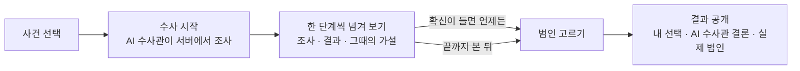
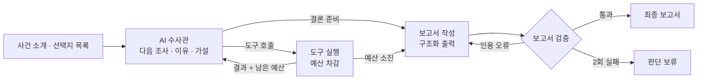
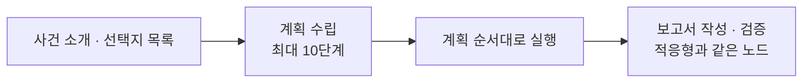

# 🔎 Cluvelle — AI 수사관과 함께 범인을 찾는 추리 서비스

> AI 수사관이 **조사 예산 10회** 안에서 스스로 조사할 곳을 고르며 사건을 수사하고, 사용자는 그 수사를 **한 단계씩 넘겨 보며 함께 추리해** 범인을 고르는 웹 서비스. 범인을 고르면 **내 선택 · AI 수사관의 결론 · 실제 범인**이 함께 공개됩니다.

| 항목 | 내용 |
|---|---|
| 기간 | 2026.11.20 ~ 진행 중 (10일 개발 계획) |
| 인원 | 1명 (개인 프로젝트) |
| 역할 | 서비스 기획 · 사건 시나리오 설계 · 조사 도구 · LangGraph 에이전트 · API · 웹 화면 · CI/CD · 배포 전체 |
| 기술 | Python · FastAPI · LangGraph · Gemini API · React · TypeScript · Tailwind CSS |
| 배포 | [웹 서비스 바로가기](https://cluvelle.vercel.app) |
| 진행 상태 | 사건 5개 · AI 수사관 · 실시간 API · 추리 화면 · 배포 완료 → 적응형/고정 계획형 비교 실험 진행 예정 |

## 🚀 바로가기

| 구분 | 링크 |
|---|---|
| 웹 서비스 (Vercel) | https://cluvelle.vercel.app |
| API 상태 확인 (Render) | https://cluvelle-api.onrender.com/api/health |
| 사건 목록 API | https://cluvelle-api.onrender.com/api/cases |

> 무료 서버라 처음 접속하면 서버가 깨어나는 데 1분 가까이 걸릴 수 있습니다. 화면에 "서버를 깨우는 중" 안내가 나오면 잠시 기다려 주세요.
> 공개 배포 비용을 막기 위해 수사 시작은 **IP당 하루 5회, 전체 하루 30회, 동시 1건**으로 제한합니다.

---

## 목차

| # | 구분 | 내용 |
|---|---|---|
| 01 | 프로젝트 개요 | 배경 · 서비스 흐름 · 기술적 질문 · 목표 · 범위 |
| 02 | 수행 범위와 기술 | 기능 진행 상황 · 기술 스택 |
| 03 | 사용자 경험 | 화면 흐름 · AI 수사관의 결론 숨기기 · 결과 화면 |
| 04 | 사건 데이터 | 사건 5개 · 데이터 구조 · 설계 규칙 |
| 05 | 조사 도구와 교차 검증 | 도구 5개 · 교차 검증 규칙 |
| 06 | AI 수사관 (LangGraph) | 적응형 · 고정 계획형 · 실행 제한 · 보고서 검증 |
| 07 | API와 실시간 스트리밍 | REST · SSE · 실행 제한 · 채점 |
| 08 | 검증과 배포 | 사건 검증 스크립트 · 테스트 · CI/CD |
| 09 | 문제 분석 및 개선 과정 | 개발 중 발견한 문제와 수정 |
| 10 | 남은 작업 | 비교 실험 · 마감 |
| 11 | 실행 방법 | 로컬 실행 · 저장소 구성 |

---

# 01. 프로젝트 개요

## 1.1 배경

추리는 단서를 하나씩 모으고, 진술과 기록이 어긋나는 곳을 찾고, 가설을 고쳐 가는 과정입니다. LLM 에이전트가 하는 일도 비슷합니다. 무엇을 먼저 볼지 고르고, 결과를 보고 다음 행동을 정하고, 근거를 들어 결론을 냅니다.

Cluvelle은 이 둘을 합쳤습니다. **AI 수사관이 실제로 도구를 골라 가며 수사하고, 사용자는 그 과정을 따라가며 직접 추리**합니다. AI 수사관은 처음부터 정답이나 단서를 보지 못하고, 사건 소개와 조사할 수 있는 곳의 목록만 알고 시작합니다.

## 1.2 서비스 흐름



- AI 수사관은 서버에서 쉬지 않고 수사하고, 화면은 받은 조사 내용을 쌓아 두었다가 **사용자가 "다음"을 누를 때 한 단계씩** 보여 줍니다
- 사용자는 AI 수사관보다 먼저 범인을 알아채면 **10단계를 다 보기 전에 고를 수 있습니다**
- 범인을 고르기 전에는 AI 수사관의 결론이 드러나지 않습니다
- AI 수사관보다 먼저 맞히거나, AI 수사관이 증거 부족으로 결론을 못 낸 사건을 맞히면 그만큼 축하 메시지가 달라집니다

## 1.3 기술적 질문

> **제한된 정보와 도구 사용 예산 안에서, 조사 결과를 보고 전략을 바꾸는 것이 실제 성능에 어떤 영향을 주는가?**

같은 사건 · 도구 · 예산 · 초기 정보로 두 방식을 실행해 비교합니다.

| 방식 | 동작 |
|---|---|
| 적응형 (서비스에서 사용) | 도구를 하나 호출할 때마다 결과를 보고 다음 조사를 정함 |
| 고정 계획형 (비교 실험 전용) | 처음에 조사 계획을 한 번 세우고 그대로 실행함 |

## 1.4 목표

- 사건 5개를 **조사 예산 10회** 안에서 풀 수 있게 설계 (최단 해결 경로 5~6회)
- AI 수사관이 **확보하지 않은 증거는 인용할 수 없도록** 서버에서 검증하고, 근거가 부족하면 **판단 보류**
- 사용자가 AI 수사관의 추리를 따라가며 **함께 범인을 찾는 경험**
- 5개 사건 × 3회 × 2방식 = **30회 실행 결과**로 적응형과 고정 계획형을 비교
- PC와 360px 이상 모바일 브라우저 지원

## 1.5 범위

| 구분 | 항목 |
|---|---|
| 포함 | 사건 5개, 조사 도구 5개, AI 수사관(적응형), 단계별 추리 화면, 범인 고르기와 결과 비교, 고정 계획형 비교 실험, 반응형 UI, 공개 배포, CI/CD |
| 제외 | 회원가입 · 로그인, 결제, 사건 자동 생성, 실제 CCTV 영상, 멀티 에이전트, 영구 사용자 기록 |

---

# 02. 수행 범위와 기술

## 2.1 기능 진행 상황

| 기능 | 상태 |
|---|---|
| 사건 목록 · 상세 · 수사 시작 | ✅ 완료 |
| AI 수사관의 도구 자율 선택 · 반복 조사 · 가설 기록 | ✅ 완료 |
| 증거 수집 · 중복 · 예산 10회 제한 | ✅ 완료 |
| 결과 보고서 (지목 또는 판단 보류, 증거 인용 검증) | ✅ 완료 |
| 실시간 이벤트 스트림 (SSE) · 끊김 시 이어 받기 | ✅ 완료 |
| 단계별 추리 화면 · 범인 고르기 · 결과 화면 · 단서 다시 보기 | ✅ 완료 |
| 반응형 UI (모바일 단일 열 · PC 2열) · 로고 | ✅ 완료 |
| 공개 배포 · CI 통과 후 자동 배포 | ✅ 완료 |
| 고정 계획형 그래프 | ✅ 완료 |
| 적응형 vs 고정 계획형 30회 비교 실험 | 진행 예정 (Day 9) |

## 2.2 기술 스택

| 영역 | 기술 | 역할 |
|---|---|---|
| Backend | Python 3.12 · uv · FastAPI · Pydantic | REST · SSE API, 사건 · 도구 · 보고서 스키마 |
| Agent | LangGraph · langchain-google-genai · Gemini API | 적응형 · 고정 계획형 수사 그래프 |
| Frontend | React 19 · Vite · TypeScript · Tailwind CSS v4 · react-router | 사건 목록 · 단계별 추리 화면 · 결과 화면 |
| 품질 | Ruff · pytest · ESLint · Prettier | 린트 · 포맷 · 테스트 |
| 배포 | Render (API) · Vercel (웹) · GitHub Actions | CI 통과 후 main 브랜치만 배포 |

> Gemini 모델은 추가 학습하지 않고, **도구 설계 · 프롬프트 · 서버 측 검증**으로 활용합니다. 배포 서버는 `gemini-3.5-flash-lite`를 사용하며 환경변수(`GEMINI_MODEL`)로 바꿀 수 있습니다.

---

# 03. 사용자 경험

## 3.1 화면 구성

| 화면 | 주소 | 내용 |
|---|---|---|
| 사건 목록 | `/` | 사건 카드 (제목 · 난이도 · 한 줄 소개 · 조사 예산) |
| 사건 상세 | `/cases/:caseId` | 소개문 · 용의자 · 장소 · 카메라 · 질문 주제, 수사 시작 |
| 수사 화면 | `/investigations/:id` | 진행 방식 안내 → "다음"으로 한 단계씩 보기 → 범인 고르기 |
| 결과 화면 | `/investigations/:id/result` | 결과 메시지 · 비교 카드 · AI 수사관 판정 · 보고서 · 수사 돌아보기 |
| 단서 다시 보기 | `/investigations/:id?review=1` | 범인을 고른 뒤 모든 단계를 펼쳐 보기 |

수사 화면의 단계 카드에는 다음 내용이 표시됩니다.

| 항목 | 예 |
|---|---|
| 조사 | 현장 조사 · 장소: 실험실 / CCTV 확인 · 주차장 비상계단 출입구 카메라 · 22:00-23:00 |
| 이 조사를 고른 이유 | 보관함이 열쇠로 열렸으므로 출입 기록을 확인한다 |
| 이때의 가설 | 자재 창고 쪽 내부 문을 통해 반출되었을 가능성을 확인해야 한다 |
| 결과 | 찾은 증거(ID · 요약) / 특이사항 없음 |

- 가설 기록, 확보 증거, 남은 예산은 **사용자가 넘긴 단계까지만** 보입니다
- 진행 상황(넘긴 단계 · 고른 용의자)은 브라우저에 저장되어 새로고침해도 이어집니다
- 모바일은 단일 열, PC는 왼쪽에 사건 정보와 가설 기록을 고정한 2열 배치입니다

## 3.2 AI 수사관의 결론 숨기기

사용자가 AI 수사관의 답을 따라가지 않고 스스로 추리할 수 있도록, 범인을 고르기 전에는 다음을 보여 주지 않습니다.

| 숨기는 것 | 방법 |
|---|---|
| 최종 보고서 · 채점 · 종료 사유 | 범인을 고른 뒤 결과 화면에서만 표시 |
| 수사 상태 | "AI 수사관 조사 중 / 조사 종료" 두 가지 중립 표현만 사용 |
| AI 수사관이 일찍 확신했다는 신호 | 웹 서비스의 수사는 **예산 10회를 모두 쓰도록** 이어 가게 함 (끝내려 하면 최대 3번까지 추가 조사를 요청) |
| 가설에 담긴 결론 | 프롬프트로 "특정 용의자가 범인이라고 단정하지 말고, 지금 보고 있는 가능성과 확인할 것을 적으라"고 지시 |
| 아직 넘기지 않은 단계 | 화면 어디에도 표시하지 않음 |

## 3.3 결과 화면

범인을 고르면 결과 화면으로 넘어갑니다. AI 수사관의 수사가 아직 진행 중이면 끝날 때까지 기다렸다가 자동으로 공개합니다.

**결과 메시지** (n = 사용자가 고른 시점의 단계, T = AI 수사관의 조사 횟수)

| 경우 | 메시지 |
|---|---|
| 단서를 보기 전에 맞힘 | 🎉 단서를 보기도 전에 범인을 맞혔어요! 직감이 대단해요. |
| AI 수사관보다 먼저 맞힘 (n < T) | 🎉 AI 수사관보다 먼저, n단계 만에 범인을 찾아냈어요! |
| 끝까지 보고 맞힘 | 🎉 AI 수사관과 함께 끝까지 단서를 따라가 범인을 맞혔어요! |
| AI 수사관은 증거 부족으로 보류, 사용자는 맞힘 | AI 수사관은 증거가 부족하다며 판단을 미뤘는데, 당신은 범인을 찾아냈어요. 정말 대단해요! |
| AI 수사관이 다른 사람을 지목, 사용자는 맞힘 | AI 수사관은 다른 사람을 지목했어요. AI 수사관보다 한 수 위예요! |
| 틀림 | 아쉬워요. 범인은 ○○이었어요. |

**AI 수사관 판정** (채점 결과를 쉬운 말로 표시)

| 판정 | 표시 | 조건 |
|---|---|---|
| full_success | 범인을 맞혔어요 | 범인 지목 + 결정적 단서 모두 확보 + 보고서에 인용 |
| partial_success | 범인을 맞혔지만 근거가 일부 부족해요 | 범인 지목, 결정적 단서 일부 미확보 또는 미인용 |
| appropriate_withhold | 신중하게 판단을 미뤘어요 | 결정적 단서를 다 찾지 못해 보류 |
| inappropriate_withhold | 단서를 다 찾고도 판단을 미뤘어요 | 결정적 단서를 모두 찾고도 보류 |
| failure | 범인을 잘못 지목했어요 | 다른 용의자 지목 |
| error | 수사 중 오류가 발생했어요 | LLM · 시스템 오류 |

---

# 04. 사건 데이터

## 4.1 사건 구성

| ID | 난이도 | 사건 | 수사 구조 | 조사 조합 | 증거 | 최단 경로 |
|---|---|---|---|---|---|---|
| CASE-001 | 입문 | 연구실 시제품 도난 | 진술과 출입 기록 충돌, CCTV 시간대 교차 확인 | 30 | 22 | 5 |
| CASE-002 | 입문 | 미술관 전시품 분실 | CCTV 사각지대와 목격자 진술 검증 | 31 | 22 | 5 |
| CASE-003 | 보통 | 호텔 객실 귀중품 도난 | 출입 기록 · 청소 일정 · 동선 비교 | 34 | 26 | 6 |
| CASE-004 | 보통 | 카페 비밀 레시피 유출 | 접근 권한 · 문서 열람 기록 · 허위 단서 | 33 | 23 | 6 |
| CASE-005 | 도전 | 공연장 소품 교체 사건 | 시간표 · 물품 이동 기록 · 서로 충돌하는 알리바이 | 30 | 25 | 6 |

- 모든 사건: 용의자 3명, 결정적 증거 3개, 오해를 유발하는 증거 2개, 조사 예산 10회
- 조사 조합 = 장소 + 용의자 × 질문 주제 + 카메라 × 시간대 + 알리바이 확인
- 조합의 일부는 "특이사항 없음"을 돌려줌 → 무작정 다 조회하면 예산이 모자람
- 모든 인물 · 기관 · 사건은 가상입니다

## 4.2 데이터 구조

사건마다 **공개 정보 파일**과 **정답 파일**을 나눴습니다.

| 파일 | 내용 | 접근 |
|---|---|---|
| `backend/data/cases/CASE-XXX.json` | 사건 소개, 용의자 · 장소 · 카메라 · 질문 주제 목록, 증거 | 목록은 공개, 증거는 도구로만 조회 |
| `backend/data/answers/CASE-XXX.json` | 범인, 결정적 · 오해 유발 증거, 해결 경로, 사건 해설 | 채점 · 사건 검증 모듈에서만 읽음 |

증거 한 건은 **어느 도구로 어디를 조회하면 나오는지**(`source_tool` + `locator`)와, 교차 검증에 쓰는 **시간 · 장소 사실**(`facts`)을 가집니다.

```json
{
  "id": "E11",
  "source_tool": "interview_suspect",
  "locator": { "suspect_id": "S3", "topic_id": "T1" },
  "summary": "15:30부터 16:00까지 창고에서 원두 포대를 정리했다.",
  "facts": [
    { "kind": "claim", "person_id": "S3", "place": "L5", "start": "15:30", "end": "16:00" }
  ]
}
```

| facts 필드 | 의미 |
|---|---|
| `kind` | `claim`(진술) / `record`(CCTV · 기록) |
| `person_id` | 인물 ID, 얼굴이 식별되지 않은 기록은 `null` |
| `place` | 장소 ID, 현장 밖이면 `off_site` |
| `start` · `end` | 같으면 그 시각의 순간 기록 |

## 4.3 사건 설계 규칙

| 규칙 | 이유 |
|---|---|
| 정답이 **한 번의 조회로 드러나지 않게** 결정적 증거를 서로 다른 위치에 분산 | 운 좋게 정답 단서를 뽑는 구조 방지 |
| 단서가 다음 조사 방향을 알려 주도록 연결 | 추론으로 경로를 찾을 수 있게 |
| 통과한 순간은 **순간 기록**으로, 체류로 늘리지 않음 | 관측보다 강한 사실이 생기지 않게 |
| 진술은 **말한 그대로** 기록 ("15:40쯤" = 순간, "~에서 ~사이" = 구간) | 추정은 문장에만 남김 |
| **서명 · 계정 입력은 사람의 위치로 기록하지 않음** | 서명 위조 · 계정 도용이 사건의 함정이 될 수 있음 |
| 배제는 반드시 기록으로 뒷받침 | 근거 없는 알리바이 단정 방지 |
| 관측된 것과 추론한 것을 사건 해설에서 구분 | 보고서가 추론을 사실처럼 쓰지 않게 |

---

# 05. 조사 도구와 교차 검증

## 5.1 조사 도구 5개

| 도구 | 화면 표시 | 입력 | 결과 |
|---|---|---|---|
| `inspect_scene` | 현장 조사 | 장소 | 현장 흔적 · 장비 기록 |
| `interview_suspect` | 심문 | 용의자 × 질문 주제 | 진술 |
| `check_cctv` | CCTV 확인 | 카메라 × 시간대 | CCTV 관찰 기록 |
| `verify_alibi` | 알리바이 확인 | 용의자 | 출입 · 근무 · 단말 기록 |
| `cross_check_evidence` | 교차 검증 | 확보한 증거 2~5개 | 증거 사이의 시간 · 장소 관계 |

AI 수사관에게는 증거 ID · 도구 · 요약 문장만 보여 주고, `facts`는 교차 검증 계산에만 씁니다.

## 5.2 교차 검증 규칙

교차 검증은 **판단하지 않고 관계만** 돌려줍니다. 결론은 AI 수사관이 내려야 합니다.

| 관계 | 의미 |
|---|---|
| `same_person_overlap_different_place` | 같은 인물, 시간대 겹침, 장소 다름 |
| `same_person_overlap_same_place` | 같은 인물, 시간대 겹침, 장소 같음 |
| `different_people_same_place_overlap` | 다른 인물, 같은 장소, 시간대 겹침 |
| `unidentified_time_overlap` | 신원 미상 기록과 시간대만 겹침 (특정 인물과 연결하지 않음) |

- 서로 다른 증거의 사실끼리만 비교
- 겹침: 공통 구간이 있거나 순간 기록이 구간 경계에 걸침. **끝점만 맞닿은 두 구간은 겹침 아님**
- 결과 문장에 "거짓 · 범인 · 모순 · 의심" 같은 결론 단어를 쓰지 않음

**예시** — CASE-004에서 "창고에 있었다"는 진술과 직원 통로 CCTV를 비교

```
['E11', 'E18'] 사실 관계 4건
  - same_person_overlap_different_place ['S3'] | E11(진술) S3 L5(창고) 15:30-16:00 / E18(기록) S3 L2(직원 통로) 15:38-15:38
  ...
```

같은 진술을 창고 CCTV와 비교하면 "장소 같음"만 나옵니다. 15:37~15:48의 공백은 CCTV 요약 문장을 읽어야 드러나도록 설계했습니다.

---

# 06. AI 수사관 (LangGraph)

## 6.1 적응형 (서비스)



- 도구를 부를 때마다 **선택 이유(reason)**와 **현재 가설(hypothesis)** 한 문장을 함께 적게 함 → 화면의 "이 조사를 고른 이유", "이때의 가설"
- 웹 서비스에서 시작한 수사는 예산이 남았는데 끝내려 하면 추가 조사를 요청 (연속 3회까지). 비교 실험에서는 이 옵션을 꺼서 AI 수사관이 멈출 때를 스스로 판단하게 함

## 6.2 고정 계획형 (비교 실험 전용)



- 교차 검증 단계는 앞 단계 번호(`source_steps`)로 대상 증거를 지정
- 보고서 작성 · 검증 노드를 두 방식이 공유해 비교 조건을 맞춤
- 공개 API로는 노출하지 않음

## 6.3 실행 제한과 검증

| 제한 | 처리 |
|---|---|
| 조사 예산 | 사건당 10회. 잘못된 인자 · 사유 누락 · 없는 도구 · 중복 호출도 1회로 셈 |
| 중복 판정 | 같은 도구 · 같은 대상이면 이유 · 가설이 달라도 중복 |
| 미확보 증거 교차 검증 | 차단하고 예산 1회 차감 |
| 남은 예산 알림 | 도구 결과마다 "남은 조사 예산: n회" 표시 |
| 보고서 검증 | 없는 용의자 · 확보하지 않은 증거 · 증거 누락을 서버에서 검사 |
| 재작성 한도 | 검증 실패 시 재작성, 총 2회 실패하면 판단 보류 |
| LLM 오류 | 요청 제한 시간 60초, 재시도 2회, 오류 기록에서 API 키 형식 가림 |

---

# 07. API와 실시간 스트리밍

## 7.1 엔드포인트

| 메서드 · 경로 | 내용 |
|---|---|
| `GET /api/health` | 서버 상태 |
| `GET /api/cases` | 사건 목록 |
| `GET /api/cases/{case_id}` | 공개 사건 정보 (정답 없음) |
| `POST /api/investigations` | 수사 시작 → `investigation_id` |
| `GET /api/investigations/{id}/events` | SSE 실시간 이벤트 |
| `GET /api/investigations/{id}/result` | 조사 기록 · 확보 증거 · 보고서, 종료 후에만 채점 포함 |

## 7.2 SSE 이벤트

| 이벤트 | 내용 |
|---|---|
| `tool_selected` | 단계 번호, 도구, 대상, 선택 이유 |
| `hypothesis_updated` | 가설이 바뀌었을 때만 |
| `evidence_found` | 찾은 증거 / 특이사항 없음 / 오류, 남은 예산 |
| `finished` · `error` | 수사 종료 |

- 이벤트마다 번호를 붙여, 연결이 끊기면 `Last-Event-ID`로 **놓친 이벤트부터 이어 받기**
- 15초마다 ping으로 연결 유지, 종료 이벤트 뒤 스트림 닫기
- 이벤트와 종료 전 응답에는 증거의 `facts`와 정답 정보를 넣지 않음

## 7.3 실행 관리와 비용 제한

| 항목 | 설정 |
|---|---|
| 실행 방식 | 백그라운드 스레드 + 메모리 저장 (uvicorn worker 1개) |
| 보관 | 종료 후 1시간, 최대 50건 |
| 동시 실행 | 1건 |
| 하루 실행 | IP당 5회, 전체 30회 (한국 시간 0시 초기화) |
| 접속 IP | 프록시 뒤라 `X-Forwarded-For`의 첫 값 사용 |

## 7.4 채점

`services/grading.py`가 최종 상태와 정답 파일을 비교해 판정을 계산합니다. 결과 화면과 비교 실험이 같은 함수를 씁니다. 정답 파일은 이 채점 모듈과 사건 검증 모듈에서만 읽습니다.

---

# 08. 검증과 배포

## 8.1 사건 검증 스크립트

사건 데이터를 고칠 때마다 설계 규칙을 자동으로 확인합니다.

| # | 검사 |
|---|---|
| 1 | 용의자 수 |
| 2 | 조사 가능 조합 수 (25~35) |
| 3 | 결정적 증거 2~3개 · 오해 유발 증거 1~2개 |
| 4 | 해결 경로 길이 (5~6) |
| 5 | 해결 경로를 실제 도구로 실행했을 때 결정적 증거를 모두 확보하는지 |
| 6 | 한 조회 위치에 결정적 증거가 2개 이상 몰리지 않았는지 |
| 7 | 증거 요약에 결론 단어가 없는지 |

```
[CASE-005] 통과
  조합 30 (증거 있음 25 / 없음 5) · 결정적 3 · 오해 2 · 해결 경로 6
전체 5건 중 통과 5건, 실패 0건
```

## 8.2 테스트

- 백엔드 pytest **231개** 통과 (사건별 교차 검증 기대값, 도구, 에이전트 그래프, 보고서 검증, 이벤트, API, 실행 제한, 채점)
- 에이전트 · API 테스트는 가짜 LLM(`ScriptedChatModel`)으로 실행 → CI에서 실제 Gemini 호출 0회
- 프론트엔드는 ESLint · 타입 검사 · Prettier · 빌드로 검사하고, 화면 흐름은 브라우저에서 확인

## 8.3 CI/CD

```mermaid
flowchart LR
    A[develop push] --> B[CI<br/>backend · frontend]
    B --> C[배포 건너뜀]
    D[develop → main PR 머지] --> E[CI<br/>backend · frontend]
    E -->|모두 통과| F[Render · Vercel<br/>deploy hook 호출]
    F --> G[/api/health 확인]
```

| 작업 | 내용 |
|---|---|
| backend | `uv sync --locked` · Ruff 린트/포맷 검사 · pytest · 사건 검증 |
| frontend | `npm ci` · ESLint · 타입 검사 · Prettier 검사 · 빌드 |
| deploy | main push에서만, 두 작업 통과 후 deploy hook 호출 → health 응답을 최대 10분 확인 |

> API 키와 deploy hook URL은 코드 · Git에 두지 않고 GitHub Secrets와 각 서비스 환경변수에만 보관합니다.

---

# 09. 문제 분석 및 개선 과정

## ① 예산을 다 쓰고 결론 없이 끝나는 에이전트

| 구분 | 내용 |
|---|---|
| 문제 | 첫 실행에서 AI 수사관이 조사만 반복하다 예산을 모두 쓰고 보고서 없이 종료 |
| 원인 | 남은 예산을 알 수 없었고, 보고서 작성이 도구 호출 루프 안에 묶여 있었음 |
| 수정 | 보고서 노드를 분리해 예산이 소진돼도 반드시 보고서를 작성. 도구 결과마다 남은 예산 표시 |
| 결과 | 같은 사건에서 범인 지목과 결정적 증거 3개 인용까지 완료 |

## ② 가설이 답을 알려 주는 문제

| 구분 | 내용 |
|---|---|
| 문제 | 단계마다 보여 주는 AI 수사관의 가설에 "누가 범인이다"가 들어가면 사용자의 추리가 의미 없어짐 |
| 수정 | 프롬프트에 범인 단정 금지 규칙 추가. 가설은 "지금 보고 있는 가능성과 확인할 것"으로 작성 |
| 결과 | 실제 실행 10단계 모두 "확인해야 한다 / 대조한다" 형태, 단정 표현 0건 |

## ③ 일찍 끝나는 수사가 결론을 드러내는 문제

| 구분 | 내용 |
|---|---|
| 문제 | AI 수사관이 확신해서 3~4회 만에 끝내면, 그 자체가 "답을 찾았다"는 신호가 되고 사용자가 볼 단서도 적어짐 |
| 수정 | 웹 서비스 수사만 예산을 모두 쓰도록 추가 조사를 요청 (연속 3회 상한으로 무한 반복 방지). 비교 실험은 기존 동작 유지 |

## ④ 관측보다 강한 사건 데이터

| 구분 | 내용 |
|---|---|
| 문제 | 복도를 지나간 순간을 "체류"로 기록해, 다른 사람의 목격 진술과 잘못 일치 판정됨 |
| 원인 | 시나리오 문장을 사실로 옮길 때 관측 범위를 넘어서 기록 |
| 수정 | 통과는 순간 기록, 진술은 말한 그대로, 서명 · 계정 입력은 사람 위치로 기록하지 않는 원칙을 세우고 사건 5개에 적용 |
| 결과 | 교차 검증 기대값을 사건마다 테스트로 고정 |

## ⑤ 겹침 판정 기준

| 구분 | 내용 |
|---|---|
| 문제 | 15:00-16:00 진술과 16:00-17:00 기록처럼 끝점만 맞닿은 구간까지 "겹침"으로 나옴 |
| 수정 | 끝점만 맞닿은 두 구간은 겹침에서 제외. 순간 기록이 경계에 걸치는 경우는 겹침으로 유지 |

## ⑥ Gemini 서버 과부하 (HTTP 503)

| 구분 | 내용 |
|---|---|
| 문제 | 기본 모델 호출이 503으로 반복 실패해 실행이 길게 멈춤 |
| 확인 | 단순 호출도 실패 → 코드가 아닌 서버 측 과부하 |
| 수정 | 요청 제한 시간 60초 · 재시도 2회 설정, 모델을 환경변수로 바꿀 수 있게 하고 배포는 경량 모델 사용 |

## ⑦ Windows 환경 차이

| 문제 | 수정 |
|---|---|
| 체크아웃한 파일이 CRLF가 되어 Prettier 검사 실패 | `.gitattributes`에 `* text=auto eol=lf` 지정 |
| Windows에 시간대 데이터(tzdata)가 없어 `Asia/Seoul` 사용 불가 | 새 의존성 없이 UTC+9 고정 오프셋으로 하루 실행 횟수 초기화 |

---

# 10. 남은 작업

| 일정 | 작업 |
|---|---|
| Day 9 | 5개 사건 × 3회 × 2방식 = 30회 비교 실험, 결과 CSV와 판정별 지표, 실패 사례 분석 |
| Day 10 | 실험 결과 정리, 배포 점검, 화면 캡처, README 완성 |

**알려진 한계**
- 수사 기록은 서버 메모리에만 있어, 서버가 재시작(배포 포함)되면 진행 중이던 수사와 결과가 사라집니다
- 범인을 고르기 전 화면에서는 AI 수사관의 결론을 숨기지만, 브라우저 개발자 도구로 응답을 직접 열면 볼 수 있습니다 (데모 서비스 범위)

---

# 11. 실행 방법

## 11.1 Backend

```bash
git clone https://github.com/dkfjalsj/Cluvelle.git
cd Cluvelle/backend
uv sync
```

Gemini API 키는 코드에 넣지 않고 `backend/.env`에 둡니다 (Git에 올라가지 않음).

```bash
# backend/.env
GEMINI_API_KEY=your-key
ALLOWED_ORIGINS=http://localhost:5180
GEMINI_MODEL=gemini-3.5-flash-lite
```

```bash
# API 서버
uv run uvicorn app.main:app --reload

# 터미널에서 수사 실행 (적응형 / 고정 계획형)
uv run python -m app.agent.cli CASE-001
uv run python -m app.agent.cli CASE-001 --mode fixed

# 사건 검증 · 테스트
uv run python ../evaluation/validate_cases.py
uv run pytest
```

## 11.2 Frontend

```bash
cd Cluvelle/frontend
npm ci
# frontend/.env 에 VITE_API_BASE_URL=http://localhost:8000
npm run dev   # http://localhost:5180
```

## 11.3 저장소 구성

| 경로 | 내용 |
|---|---|
| `backend/app/api/` | health · 사건 · 수사(REST · SSE) 라우터 |
| `backend/app/schemas/` | 사건 · 정답 · 도구 결과 · 보고서 · 계획 · API 스키마 |
| `backend/app/services/` | 사건 불러오기, 정답 로딩, 사건 검증, 채점, 실행 관리, 실행 제한 |
| `backend/app/tools/` | 조사 도구 4개 · 교차 검증 |
| `backend/app/agent/` | 적응형 · 고정 계획형 그래프, 보고서 노드, 이벤트 변환, 프롬프트, CLI |
| `backend/data/cases/` · `answers/` | 사건 5개의 공개 정보 · 정답 |
| `backend/tests/` | pytest (가짜 LLM 포함) |
| `evaluation/` | 사건 검증 스크립트 (30회 비교 실험 추가 예정) |
| `frontend/src/pages/` | 사건 목록 · 상세 · 수사 · 결과 화면 |
| `frontend/src/components/` | 단계 카드 · 가설 기록 · 범인 고르기 · 결과 메시지 · 보고서 등 |
| `.github/workflows/ci.yml` | CI · 배포 |
